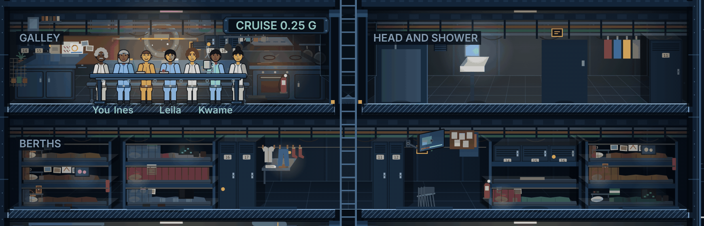

# The look

Status: approved by the owner on 2026-11-11, written from fourteen rounds of a mockup the owner corrected in conversation. It covers the burn view, the cutaway of the ship in flight. The interface, the ports and the people's portraits come later. `voice.md` is how the game reads; this page is how the burn view looks.

The ship is drawn the way the bible describes her: an old working hull, cramped, owned by a finance house on paper and lived in by people who rent everything else. The drawing should let a player tell who sleeps where without reading a name.

## The direction

**A clean frame around a worn ship.** The frame is the instruments a crew reads: the hull in section, the cut through the bulkheads and decks, the room labels, the burn bar. It is drawn like a cutaway illustration: clean lines, cold blue, every room readable at once. Inside the frame the ship is a used freighter: cramped, practical, patched, and personal. The contrast carries the setting.

The owner's references: used-future freighters of film for the inside, and technical cutaway illustration for the frame. They are for mood. Nothing is copied.

## The reference frame

`look-target.png` is the galley, the head and shower, and the berths, at 1280x800 in the game's own renderer. It was drawn as extras over the game's flat drawing in a throwaway mockup, so treat it as a sketch of the target, not a pixel target. What it gets right: the cramped space, the room box in depth, the light, the overhead runs, the stowage, and bunks that each belong to someone. What it gets wrong: the galley's own furniture is the game's flat drawing, and the depth is laid over the rooms rather than built into them. The burn view passes (#932 to #936) draw the real thing.

## The rules

1. **Cramped.** People live on top of each other. Every wall carries stowage, the overhead carries pipe runs, cable trays and ducts, and there is little headroom over a standing person. A person stands about 85 of a deck's 100 units, so the space is shrunk across, not down. The hull is 720 units wide, about 15 m, the mockup's width since #1023. Bunks stack three high.
2. **Every room is a box in perspective.** One-point perspective, the vanishing point at the room's centre at eye height. Each room shows a strip of floor receding to its back wall, a sliver of ceiling, and side walls angled in. The back wall is shaded as a curve, because the hull is a cylinder (#988).
3. **Solid things show their depth.** A table, a worktop, a hob, a basin, a desk, a locker or a bunk frame shows its top, and the side toward the centre (the side the perspective shows, as the reference frame's locker does; corrected 2026-11-11, #1024). Things stand on the floor with a contact shadow under them. The cut through the hull is the nearest thing and the darkest. Things are not set back at different depths (the owner chose the room box, 2026-11-11).
4. **Not everything faces square on.** Folding chairs lean, a desk is angled, a screen turns on its arm. Standing and sitting people face you, except on a chair: there they are side-on and face the way the chair faces (#978, #985).
5. **Things are mounted the way real ones are.** A screen on a wall is fixed flush to the bulkhead. A screen on an arm has a plate, the arm's joints, and the arm meeting its back. A shelf has brackets, a curtain has a rail, laundry has pegs. Nothing floats.
6. **Objects read as the real thing.** A mug has a handle. A locker has vents, a number plate and a handle. A shirt is a shirt's shape, not a rectangle. A blanket is rumpled and turned down at the edge.
7. **One plan for each kind of space, its own contents.** Every bunk has the same plan: the pillow and a small shelf over it at the head end, with a reading lamp under the shelf; photos pinned in a row on the back wall, at eye level lying down; the screen on the back wall at the foot end; a towel over the end rail; the curtain on its rail in front. What fills it is the occupant's own. The galley's notes, calendar and drawings are pinned to one board, not scattered.
8. **The clutter is someone's.** A few things that belong to one person, not a share of everything. One bunk has a row of family photos, a child's drawing and a call home on the screen. Another has prayer beads and an icon, another a controller and a game. One bunk has nothing out at all, and one is stripped because someone left at the last port. A person's things come from their sheet in `people/` (#934).
9. **Wear is plausible, not decorative.** The deck is scuffed where feet go and the paint worn where hands go. The bulkhead is stained by the stove, a panel patched, a fitting mismatched.
10. **Warm light in a cold hull.** Warm lamps make pools of light: over the mess table, at the stove, the reading lamps in the bunks. Against them the hull is cold blue, with dark corners. A screen casts cool light on the person watching it. People are the brightest thing, props are in the middle, and walls are dark (#959).

These rules stand from earlier decisions:
- Nothing is drawn under 12 px.
- One scale for the props (#960).
- Reduced motion keeps the camera and the flip still.
- Desktop only (#937).

## Checking a burn view change

Before a change to the burn view ships, look at a screenshot at 1280x800 next to `look-target.png`, and ask:

- Does a new object read as the real thing, mounted or standing where it would be?
- Does it fit its space's plan, and its owner?
- Does it show its depth (a top, a side, a shadow)?
- Is it lit as the room is lit, warm or cold?
- Is anything new floating, square on where it would turn, or the same as its neighbours?

## What this asks of the game

The owner decided all four on 2026-11-11. Each is its own piece of work:

- **A narrower hull, and bunks three high (#1023).** The Ice Hauler's layout narrows from 880 units to 720 (`LAYOUTS.freighter`, `js/layouts.js`). Rooms, seats and routines are laid out in shares of the width, so the change is mostly in the data, but every burn view pin and screenshot moves. The crew's bunks stack three high instead of two (`berthBunk`, `js/rooms.js`), each sleeper in their own tier and each bunk at least 80 long (#976).
- **The room box in depth (#1024).** Each room's floor, ceiling and side walls in perspective, and solid faces on its furniture. This is a change to how `js/rooms.js` draws every room, with a spec first. It goes with the lighting pass (#932) and the detail pass (#933).
- **The occupants' things (#934).** Each crew member's bunk is filled from their sheet in `people/`, by the bunk's plan.
