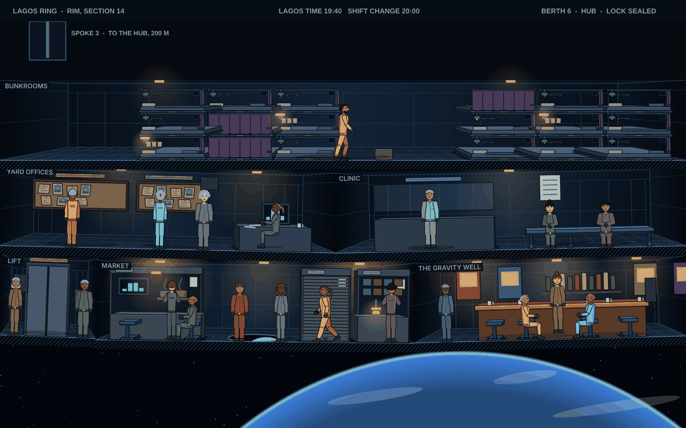

# The ports

Status: approved by the owner on 2026-11-12 (#1099), with the open questions answered as below. It covers what the port view is, and Earth's port first, since the game starts there. `look.md` is how the burn view looks; this page is how a port is put together and what it looks like, and it takes the burn view's rules where they fit. Each place's own page in this bible is what fills its port.

## The port view

A port is drawn the way the ship is: a cutaway in a clean frame, the rooms as boxes in depth, warm light in a cold structure, and people on their own routines. The frame is the port authority's: the berth number, the lock's status, the local time. Inside it, the port is a working place that a few people own and many people rent.

What the view cuts through is the part of the port a crew uses: the berth and its lock, the way from the lock to the rest of the port, and the places along it where people eat, drink, hire, buy and sleep. It is not the whole port. A station shows a slice of it; a port on the ground shows a street or a concourse.

People on the view keep the hours of the place, not of the ship. A dock crew works its shifts, a stall opens and shuts, the bar fills when a shift ends. The hand and the ship's crew are among them while the ship is in, and the port's scenes start from where its people are: a regular at the bar, the clerk at the yard office, a main character at a stall.

The rules from `look.md` that carry over unchanged: cramped where space is paid for, every room a box in perspective, solid things showing their depth, things mounted the way real ones are, objects reading as the real thing, clutter that is someone's, wear that is plausible, warm light in a cold hull, nothing under 12 px, desktop only.

What a port adds:

1. **Who owns it shows.** A port is a business. The owner's marks are on what the owner controls: the lock, the meters, the lease plates on the stalls, the price boards. What a tenant owns is their own: a stall's awning, a bunk's photos, a bar's posters.
2. **Everything is paid for.** Air, water, power, berth time and a seat at the bar are metered or charged, and the meters are where people can see them.
3. **The port is older than the ship's visit.** Signs over signs, a stall that used to sell something else, a lease plate with a name scratched out.

## Earth: Lagos Ring

Earth's port, for a torch ship, is Lagos Ring (`lagos.md`). Torch ships do not light their drives inside Earth's traffic zone, so a tug brings the ship in to the Ring's hub and takes her out again. Everything to or from the ground goes by spaceplane between the hub and the Lagos launch platform. The hand signs on with Hester here.

The Ring is about four hundred metres across and turns one and a half times a minute: half a g on the rim, none at the hub. About six thousand people live on it. It belongs to Lagos Arcology's holding company, which charges for the air and the water and sets the rents, in Lagos scrip. Its police and its customs are the arcology's.

### The reference frame

`ports-target.png` is a slice of the rim at 1280x800, drawn with the game's own room and figure drawing in a throwaway mockup, three rounds with the owner (2026-11-12). Treat it as a sketch of the target, as `look-target.png` is for the burn view. What it gets right: three levels of the rim in boxes in depth, the market as bays rented in the wall, the bar's copper counter, the hiring boards, bunks three high, the Ring's own people in their own colours beside a ship's crew, and Earth under the hull. What it leaves for the real drawing: the curve of the rim (true to scale it is a few units over the slice, too little to read), the spoke joining the lift, clothes beyond a colour, and the berth at the hub.

### What the view cuts through

From the ship's berth down to the rim, in the order a hand walks it:

1. **The berth, at the hub.** The dock is on the axis, where the Ring barely turns, and is weightless. The ship's lock meets the berth's collar. Handrails, a cargo net and a freight sled on its track; a tug's crew drinking from bulbs by the collar between jobs. The berth's meter on the wall counts the hours at the berth rate. The customs office is here, at the head of the berths, with the arcology's mark on its hatch.
2. **The spoke lift.** A car on a rail down one of the spokes, two hundred metres from the hub to the rim. Weight comes back on the way down; people sit for it and strap a bag between their feet. The car takes twelve, and at a shift change it runs full both ways. At the rim it comes down a well through all three levels, with its doors on each, and a stair winds up beside it for anyone who will not wait for the car, as the Ore Runner's ladder well does aboard (`look.md`). The well is how every room on the rim is reached: the lobby at its foot, the yard offices and the clinic off its middle landing, the bunkrooms off its top one (#1124).
3. **The rim.** A slice of it, about forty metres long, three levels deep. The floor of each level rises gently at both ends of the view, because the rim curves; over forty metres it rises about a metre. The outermost level is at half a g, the ones above it a little less.
   - **The market,** on the outermost level: bays rented in the wall, each a steel frame with a roll-down shutter, its lease plate on the frame and its permit card for the year in the corner, and a counter in front. What is inside is the tenant's: a hob and pans and a menu screen, parts bins and a lamp on an arm. A bay between tenants has its shutter down. No awnings: nothing on the Ring is built as if it were outside (the owner, 2026-11-12). Ngozi Achebe's food stall is here, feeding the yard shifts (`lagos.md`). A port in the floor at the market's middle shows the stars, and Earth going by every forty seconds.
   - **The bar,** the Gravity Well (`js/bar.js`), off the market: a long copper counter, travel posters from a dozen ports curling on the walls, and the drinks priced in scrip and in trade notes.
   - **The yard offices,** on the level above: the agencies' hiring boards for refit contracts, and the yard's own office where a ship's refit is signed.
   - **The clinic,** under contract, next to the yard offices.
   - **The bunkrooms,** on the top level: agency berths, three high, each held as long as its contract.

### Its people

- The dock crew at the hub and the tug crews, on the yard's shifts.
- Yard workers on contract from the mainland, in the bunkrooms between shifts, at the hiring boards between contracts.
- Leaseholders who run what the workers need: the stalls, the bar, a repair shop.
- The customs officers at the head of the berths, on the arcology's rota.
- Main characters with a reason to be here: Tomas, who worked the yard for most of twenty years, and his sister Ngozi at her stall.

The Ring keeps Lagos time. The lights on the rim go down at Lagos's night, and the yard works three shifts through it.

## Ceres: the station

Status of this section: draft for the owner's review, 2026-11-15 (#1247). The place is `ceres.md`; its people are `regulars.md` and `powers-people.md`. It is written to the same rules as the Ring's, so the view can be built as the second port's layout (`PORT_LAYOUTS`, `js/portview.js`; #1256).

Ceres Station is the Guild Council's (`ceres.md`): the yard and the docks on a crater floor, at a thirtieth of a g, and the town dug into the crater wall, in caverns with a drum turning in each for weight, the rings. The view is a cut through the crater wall: the surface at the top, the shaft down through the rock on the left, and a slice of an upper ring and of the lower ring below it, each a turning drum shown as its floor and its rooms, the rock between them.

### The reference frame

`ceres-target.png` is the cut at 1280x800, drawn with the game's own room and figure drawing in a throwaway mockup, two rounds with the owner (2026-11-15), as `ports-target.png` is for the Ring. What it gets right: the surface as outside, with the ship's lower hull on her pad, her legs and bell, cut by the frame, and the walkway to the lock; the co-op's office with its stall, counter, board of hulls and back room; Kaur's counter and the Guild's room side by side, the strike's two sides; the Warren widest, with its counter, the ration over the taps and the shrine at its end. What it leaves for the real drawing: the rings' curve, stronger than the surface's, which stays flat; the low weight on the crater floor in how people walk; signs a figure stands in front of; the renters' rooms at their own scale.

### What the view cuts through

From the ship's pad down to the Warren, in the order a hand walks it:

1. **The pad and the lock, on the crater floor.** The ship sits on her pad under the floodlights, and a pressurised walkway runs from her lock to the station's. The lock office is the council's, with the Guild Federation's mark on the hatch: the customs, and the dockmaster's window. Outside, on the yard's side, the **yard gate**, with a bench beside it, and the **co-op's office**, two rooms up a stair from the yard floor: a counter, a board with the hulls on it, and a back room (`ceres-coop.md`). A noodle stall stands under the stair. At a thirtieth of a g, people move in long slow steps and hold the rails.
2. **The shaft.** A lift car on a rail down a shaft through the rock, and the long stair beside it that the yard crews use when the car is slow. Weight comes back at the ring's hub door: people step off the car, through the hub, and down the ring's spoke stair to its floor, at about a third of a g.
3. **An upper ring.** A slice of its floor, curving up gently at each end, as the Ring's does:
   - **the market:** the council's trade floor, stalls round it, the water ration posted on a board;
   - **the Guild's office:** the Ice Haulers' Guild's room, a board of names, Mirela Sandoval's desk (`powers-people.md`);
   - **Kaur's buying office:** a counter with a price board for ice, the chief buyer behind it;
   - **the clinic:** the council's, on the guilds' cover.
4. **The lower ring, the Warren.** Older and colder, its floor lower and its light worse:
   - **the Warren:** the bar the lower rings are named for, three deep at a shift change, the water ration over the taps, the floor tilting with the ring's curve (`js/bar.js`);
   - **the laundries and the rooms:** the renters' rooms by the month, a laundry with its machines running;
   - **the shrine:** for the people the ice took, with the names on it.

What the view leaves out: the yard's cradles beyond the gate, the ice house below the Warren, the council's chamber, the docks' far pads. They are there, and named in scenes.

### Its people

- **The fixed people,** the same on every visit (as the Ring's leaseholders and staff, How a port runs, below): the dockmaster at the lock office, the Warren's keeper, the stallholder under the co-op's stair, the clinic's nurse, the Guild's organiser, Kaur's chief buyer.
- **The regulars,** drawn for the run (`regulars.md`, Ceres Station and the Warren): the Warren's stools, the bench at the yard gate. A regular whose place is the noodle stall or the co-op's counter is that place's person when the run draws them; otherwise the place has its fixed person.
- **Yard crews and dock crews** on the shifts: down the long stair at a change, at the Warren after.
- **The co-op's members** between hulls, at the co-op's office and the Warren.
- **The ship's crew ashore:** in the market by day and at the Warren after, as at the Ring.
- **Main characters with a reason to be here:** Bexa and Pax, from chapter 2, or as the run draws them (`chapter-2.md`, The cast).

### Its hours

Ceres time, a day of twenty-four hours, three yard shifts (`ceres.md`). The market opens with the first shift and closes with the second. The Warren is busiest at the change from the second shift to the third. The rings' lights go down at the station's night, the Warren's last. The surface keeps its floodlights on through every shift.

### Its scenes' places

Where a scene at Ceres gathers (#1103): the share and the meetings at the co-op's office; the strike's organiser at the Guild's office; the bar's talk at the Warren; the day ashore in the market; repairs at the yard gate; a landing's arrivals at the lock. Offers (above) show here as at the Ring: on the room, or over the person.

## The screen in port

How the port view and the port's pages share the screen (for #1101). Draft for the owner, 2026-11-12.

- **The view is the main area,** as the burn view is in flight. The painted backdrop strip goes at a port that has a view.
- **The pages open docked over it.** Choosing a page on the rail (Port, Missions, Bar, Crew and the rest) opens it in a panel docked to one side of the view, as a scene opens in the burn view's dock (`dockEventPanel`, `js/transit.js`), and the view stays live in the part it leaves clear. Closing the page gives the whole view back. The rail stays where it is. As the burn view's dock does, the page sits beside the view on a wide window and under it on a narrower one, where beside it would leave the view too small to read (the owner, 2026-11-13; #1132).
- **A scene opens in the same dock,** with its people walked to where it happens on the view.
- **What stays on screen with nothing open:** the frame's bar (the section, the local time, the berth), the notes as a ticker under the view (as the burn view's comms ticker), and the dock's main button (Sail with the captain, Pass the night).
- **A click on the view** finds what is there, as a click in the burn view does: a person opens what is theirs (a regular's talk, a leaseholder's word), a room opens its page (the Gravity Well the Bar, the yard office Missions, the market the Port page).
- **The camera** pans along the rim and between its levels, after the hand, as the burn view's pans the decks; reduced motion cuts instead.

## How a port runs

The rules the port's people and scenes keep (for #1102 and #1103). Draft for the owner, 2026-11-12. Most of it is ship life's (`js/shiplife.js`) carried ashore; this says what a port changes.

### The port's clock

The game's day turns by passing a night in port, by the port's clock reaching midnight, or by sailing. Inside that day the port has its own hours. A landing comes in at the hour the burn ended, by the port's local time (Lagos time on the Ring), and the view runs on from there at the burn view's pace: a day of the port's hours in 80 seconds (`SHIP_DAY`, `js/shiplife.js`). It runs through the evening and on through the night (the owner, 2026-11-15, #1275): the rim's lights down, the bays shut, the bar the last thing open. At midnight the day turns, as a night passed does: the date moves on (and the ship's contract counts it), the bar fills again, and the night can bring something to the dock; with a stay on, it is a night of the stay. The speed buttons run it faster, or pause it. A scene stops the clock while it is open, as it stops the burn.

### Who is there

- **Fixed people,** the same on every visit, with records like the crew's so they can be talked to and remember: the port's leaseholders (Ngozi at her food bay, the repairer, the Gravity Well's keeper), the yard clerk, the clinic's nurse. A main character who lives here (Ngozi) is one of them.
- **People drawn for the visit:** the yard workers on and off shift, and the bar's regulars, who are the bar's patrons already drawn at landing (`fillBar`, `js/bar.js`), not a second set. A night in port draws them again, as the bar is filled again now.
- **The ship's crew,** ashore from the landing to the sailing: at the bar, at a bay, walking the rim, back aboard to sleep.
- The draw for the visit uses the port's own dice, seeded from the port and the day, so a landing moves no other system's rolls (as ship life's dice).

### Their hours

Each fixed person has a routine by the port's hours, as the crew have the ship's: open the bay, work it, eat, shut it, go home. The yard works three shifts; a shift change fills the lift lobby and then the bar. The routine blocks are the port's, written per place in its layout, so the next port is new data.

When the hour moves someone, they walk there, at the crew's pace aboard: along a level, and up or down the well, one storey by the stair and more by the car (#1124). Someone the hour brings comes down the spoke in the car; someone it takes goes up it. Reduced motion puts everyone in their place.

### A landing's scenes at a port with a view

The owner, 2026-11-14. At a port with a view, a landing's scenes are offers on the view, as the burn's are offers on the ship (`burn.md`). The player opens them when they choose, by a click, in place of a run of dialogs before they have looked around.

- **What opens at once.** The customs check, first, as now (the lock's business). Then the settling up: the first officer's arrival, and chapter two's end. Then the mourning of a crewmate lost on the run. These open in that order as soon as the ship is in, docked, with their people walked to them, and a landing's two-scene cap (#1096) still holds for them. They are the port's urgent events, as contacts and fate scenes are the burn's.
- **What waits as an offer.** Everything else:
  - the run's business at the yard office: the freight agent, a repair or parts, an away job;
  - people: a family visit, a crewmate back from their room, someone from a day down;
  - what the port brings: its happenings.
- **Where an offer is.** Each is a tag on the view, over the person it is about where they are, or on the room it belongs to (the yard office for business, the bar for the bar's). It is the burn's tag (#1183), drawn on the Ring. At most four show at once; another waits for a place.
- **Only where it is true.** An offer about someone shows only while they are on the view, in their hours, and over them, so it moves with them. While they are off it waits, and its time runs on.
- **When it goes.** An offer lasts until the port's day turns at a night in port, or until the ship sails, whichever is first: the port's day, as the burn's offer lasts a ship's day. Letting it lapse costs nothing. A people scene that lapses comes round again at a later landing, as a missed draw does on a burn; business and happenings do not.
- **A click on a tag** opens its scene in the dock, its people walked to it, and the clock holds while it is open, as now (#1103).
- **A port with no view,** and a site, keep the landing as it is: the scenes open in turn, ranked as #1096 sets out.
- **The day ashore and the day down** stay buttons on the Port page for now. Their entries becoming offers on the view, as downtime's do on the burn (#1185), is its own piece of work, after this.

### Scenes from people

- A scene names its people (the event's `people`). Those who are on the view walk to where it happens, as a burn scene stages the crew (`stageScene`), and it opens docked when they are there. Someone in the scene who is not at this port (a contact by message, a captain at another berth) is not drawn; the scene opens as it does now.
- A scene that belongs to a place (the bar's talk, a job at the yard office, the day ashore's entries) starts there: the hand walks to it first.
- A click on a fixed person outside a scene opens their word for the day: a line, or what they offer (a meal at Ngozi's, a contract at the clerk's desk).

## What this changes in the game

Each is its own piece of work, once the owner has corrected this page:

- **Earth's port is the Ring, not an elevator.** The port's description (`SYSTEMS.earth`, `js/data.js:66`) and the Earth sign-on (`scene:sign-on`, `text.earth` and `away.earth` in `js/hiredscenes.js`: the queue at the foot of the elevator, the tide gates below) are rewritten for the Ring. The bible has no elevator, and these are the only places the game has one.
- **The port view for the Ring,** drawn to the rules above, with its people on routines as the crew are on the ship (`js/shiplife.js`).
- **The port's scenes from its people:** the bar, the day ashore, the jobs and the sign-on start from where someone is on the view.

## Later

- **Going down to the other Earth cities** (Lisbon, Rotterdam, Chittagong), after Lagos (below).
- **The information a port carries** (prices, the boards, the missions, standing) stays on the pages for now. The view comes first; what the pages become follows from it.

## Going down to Lagos

Approved by the owner, 2026-11-14. The owner chose, on 2026-11-14:
- **What it is for:** all three: family where they live, a day down, and work down there.
- **Where:** Lagos only in the first pass.
- **How it looks:** scenes first, as the day ashore is now. A drawn street or concourse comes later.

### The trip

The ship never lands: a torch ship stops at the Ring. The hand goes down alone, on the spaceplane from the hub to the Lagos platform, and comes back up on the evening flight.

- **When:** only while the captain is waiting at the Ring for a shipper (`stay.js`), when the dock's main button is "Pass the night". A trip down uses a day of the stay: the hand goes down in the morning and is back for the night, and the night passes as it does now.
- **The fare:** a seat down and back, from the hand's own savings: 900 cr. Lift off Earth is what the Lagos holding company sells (`owners.md`, `economy.md`), and Lagos's is the cheapest. A drink at the Gravity Well is 200 cr and a day's wage is 500.
- **Where it lands:** the platform, offshore. A ferry takes passengers in through the sea wall to the arcology. The mainland (Surulere, Yaba) is across the lagoon, outside the wall and outside the arcology (`lagos.md`).

### What a day down is

1. **A day down.** It works like the day ashore: a short menu, taken in turn by the day. It offers the arcology's tiers behind the wall, the mainland market, the generator man and the shared corridor, and the platform's departure hall. Lines are in the voice, from `lagos.md`.
2. **Family, where they live.** Tomas's parents, Emeka and Chioma, rent the flat in Surulere he grew up in (`people/tomas.md`). When Tomas trusts the hand, as a visit home asks, he asks the hand to take them something. The visit is at their table, as `visitHome` is, with the same choice of what to tell them. The hand's own family waits until their city is decided (below).
3. **Work down there.** Jobs on the platform and in the arcology, through the station's job system (`jobs.js`, a job's `where`), listed with the station's when the hand goes down.

### Settled with the owner (2026-11-14)

1. **The fare** is 900 cr.
2. **The hand's own home** is left open. The first pass visits Tomas's parents only, and the hand's own family waits until their city is decided.
3. **The hand goes down alone.** Tomas sends something to his parents with them.

## Settled with the owner

1. The view runs from the berth at the hub, down the spoke lift, to a slice of the rim.
2. The Earth start: the hand grew up in an arcology and comes up to the Ring on a spaceplane for the job, as the yard workers come up for a contract.
3. The bar keeps its name, the Gravity Well, and its copper counter.
