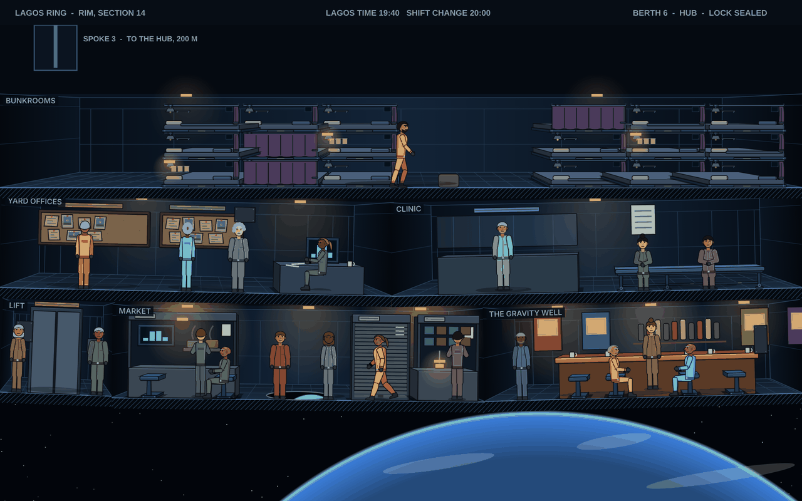

# The ports

Status: approved by the owner on 2026-11-12 (#1099), with the open questions answered as below. It covers what the port view is, and Earth's port first, since the game starts there. `look.md` is how the burn view looks; this page is how a port is put together and what it looks like, and it takes the burn view's rules where they fit. Each place's own page in this bible is what fills its port.

## The port view

A port is drawn the way the ship is: a cutaway in a clean frame, the rooms as boxes in depth, warm light in a cold structure, and people on their own routines. The frame is the port authority's: the berth number, the lock's status, the local time. Inside it, the port is a working place that a few people own and many people rent.

What the view cuts through is the part of the port a crew uses: the berth and its lock, the way from the lock to the rest of the port, and the places along it where people eat, drink, hire, buy and sleep. It is not the whole port. A station shows a slice of it; a port on the ground shows a street or a concourse.

People on the view keep the hours of the place, not of the ship. A dock crew works its shifts, a stall opens and shuts, the bar fills when a shift ends. The hand and the ship's crew are among them while the ship is in, and the port's scenes start from where its people are: a regular at the bar, the clerk at the yard office, a main character at a stall.

The rules from `look.md` that carry over unchanged: cramped where space is paid for, every room a box in perspective, solid things showing their depth, things mounted the way real ones are, objects reading as the real thing, clutter that is someone's, wear that is plausible, warm light in a cold hull, nothing under 12 px, desktop only.

What a port adds:

1. **Who owns it shows.** A port is a business. The owner's marks are on what the owner controls: the lock, the meters, the lease plates on the stalls, the price boards. What a tenant owns is their own: a stall's awning, a bunk's photos, a bar's posters.
2. **Everything is paid for.** Air, water, power, berth time and a seat at the bar are metered or charged, and the meters are where people can see them.
3. **The port is older than the ship's visit.** Signs over signs, a stall that used to sell something else, a lease plate with a name scratched out.

## Earth: Lagos Ring

Earth's port, for a torch ship, is Lagos Ring (`lagos.md`). Torch ships do not light their drives inside Earth's traffic zone, so a tug brings the ship in to the Ring's hub and takes her out again. Everything to or from the ground goes by spaceplane between the hub and the Lagos launch platform. The hand signs on with Hester here.

The Ring is about four hundred metres across and turns one and a half times a minute: half a g on the rim, none at the hub. About six thousand people live on it. It belongs to Lagos Arcology's holding company, which charges for the air and the water and sets the rents, in Lagos scrip. Its police and its customs are the arcology's.

### The reference frame

`ports-target.png` is a slice of the rim at 1280x800, drawn with the game's own room and figure drawing in a throwaway mockup, three rounds with the owner (2026-11-12). Treat it as a sketch of the target, as `look-target.png` is for the burn view. What it gets right: three levels of the rim in boxes in depth, the market as bays rented in the wall, the bar's copper counter, the hiring boards, bunks three high, the Ring's own people in their own colours beside a ship's crew, and Earth under the hull. What it leaves for the real drawing: the curve of the rim (true to scale it is a few units over the slice, too little to read), the spoke joining the lift, clothes beyond a colour, and the berth at the hub.

### What the view cuts through

From the ship's berth down to the rim, in the order a hand walks it:

1. **The berth, at the hub.** The dock is on the axis, where the Ring barely turns, and is weightless. The ship's lock meets the berth's collar. Handrails, a cargo net and a freight sled on its track; a tug's crew drinking from bulbs by the collar between jobs. The berth's meter on the wall counts the hours at the berth rate. The customs office is here, at the head of the berths, with the arcology's mark on its hatch.
2. **The spoke lift.** A car on a rail down one of the spokes, two hundred metres from the hub to the rim. Weight comes back on the way down; people sit for it and strap a bag between their feet. The car takes twelve, and at a shift change it runs full both ways.
3. **The rim.** A slice of it, about forty metres long, three levels deep. The floor of each level rises gently at both ends of the view, because the rim curves; over forty metres it rises about a metre. The outermost level is at half a g, the ones above it a little less.
   - **The market,** on the outermost level: bays rented in the wall, each a steel frame with a roll-down shutter, its lease plate on the frame and its permit card for the year in the corner, and a counter in front. What is inside is the tenant's: a hob and pans and a menu screen, parts bins and a lamp on an arm. A bay between tenants has its shutter down. No awnings: nothing on the Ring is built as if it were outside (the owner, 2026-11-12). Ngozi Achebe's food stall is here, feeding the yard shifts (`lagos.md`). A port in the floor at the market's middle shows the stars, and Earth going by every forty seconds.
   - **The bar,** the Gravity Well (`js/bar.js`), off the market: a long copper counter, travel posters from a dozen ports curling on the walls, and the drinks priced in scrip and in trade notes.
   - **The yard offices,** on the level above: the agencies' hiring boards for refit contracts, and the yard's own office where a ship's refit is signed.
   - **The clinic,** under contract, next to the yard offices.
   - **The bunkrooms,** on the top level: agency berths, three high, each held as long as its contract.

### Its people

- The dock crew at the hub and the tug crews, on the yard's shifts.
- Yard workers on contract from the mainland, in the bunkrooms between shifts, at the hiring boards between contracts.
- Leaseholders who run what the workers need: the stalls, the bar, a repair shop.
- The customs officers at the head of the berths, on the arcology's rota.
- Main characters with a reason to be here: Tomas, who worked the yard for most of twenty years, and his sister Ngozi at her stall.

The Ring keeps Lagos time. The lights on the rim go down at Lagos's night, and the yard works three shifts through it.

## The screen in port

How the port view and the port's pages share the screen (for #1101). Draft for the owner, 2026-11-12.

- **The view is the main area,** as the burn view is in flight. The painted backdrop strip goes at a port that has a view.
- **The pages open docked over it.** Choosing a page on the rail (Port, Missions, Bar, Crew and the rest) opens it in a panel docked to one side of the view, as a scene opens in the burn view's dock (`dockEventPanel`, `js/transit.js`), and the view stays live in the part it leaves clear. Closing the page gives the whole view back. The rail stays where it is.
- **A scene opens in the same dock,** with its people walked to where it happens on the view.
- **What stays on screen with nothing open:** the frame's bar (the section, the local time, the berth), the notes as a ticker under the view (as the burn view's comms ticker), and the dock's main button (Sail with the captain, Pass the night).
- **A click on the view** finds what is there, as a click in the burn view does: a person opens what is theirs (a regular's talk, a leaseholder's word), a room opens its page (the Gravity Well the Bar, the yard office Missions, the market the Port page).
- **The camera** pans along the rim and between its levels, after the hand, as the burn view's pans the decks; reduced motion cuts instead.

## How a port runs

The rules the port's people and scenes keep (for #1102 and #1103). Draft for the owner, 2026-11-12. Most of it is ship life's (`js/shiplife.js`) carried ashore; this says what a port changes.

### The port's clock

The game's day turns only as it does now: by passing a night in port or by sailing. Inside that day the port has its own hours. A landing comes in at the hour the burn ended, by the port's local time (Lagos time on the Ring), and the view runs on from there at the burn view's pace: a day of the port's hours in 80 seconds (`SHIP_DAY`, `js/shiplife.js`). It runs through the evening and stops at the night: the rim's lights down, the bays shut, the bar the last thing open. It waits there until the player passes the night (the next morning) or sails. A scene stops the clock while it is open, as it stops the burn.

### Who is there

- **Fixed people,** the same on every visit, with records like the crew's so they can be talked to and remember: the port's leaseholders (Ngozi at her food bay, the repairer, the Gravity Well's keeper), the yard clerk, the clinic's nurse. A main character who lives here (Ngozi) is one of them.
- **People drawn for the visit:** the yard workers on and off shift, and the bar's regulars, who are the bar's patrons already drawn at landing (`fillBar`, `js/bar.js`), not a second set. A night in port draws them again, as the bar is filled again now.
- **The ship's crew,** ashore from the landing to the sailing: at the bar, at a bay, walking the rim, back aboard to sleep.
- The draw for the visit uses the port's own dice, seeded from the port and the day, so a landing moves no other system's rolls (as ship life's dice).

### Their hours

Each fixed person has a routine by the port's hours, as the crew have the ship's: open the bay, work it, eat, shut it, go home. The yard works three shifts; a shift change fills the lift lobby and then the bar. The routine blocks are the port's, written per place in its layout, so the next port is new data.

### Scenes from people

- A landing's scenes are queued and ranked as #1096 sets out; the port view does not change which play.
- A scene names its people (the event's `people`). Those who are on the view walk to where it happens, as a burn scene stages the crew (`stageScene`), and it opens docked when they are there. Someone in the scene who is not at this port (a contact by message, a captain at another berth) is not drawn; the scene opens as it does now.
- A scene that belongs to a place (the bar's talk, a job at the yard office, the day ashore's entries) starts there: the hand walks to it first.
- A click on a fixed person outside a scene opens their word for the day: a line, or what they offer (a meal at Ngozi's, a contract at the clerk's desk).

## What this changes in the game

Each is its own piece of work, once the owner has corrected this page:

- **Earth's port is the Ring, not an elevator.** The port's description (`SYSTEMS.earth`, `js/data.js:66`) and the Earth sign-on (`scene:sign-on`, `text.earth` and `away.earth` in `js/hiredscenes.js`: the queue at the foot of the elevator, the tide gates below) are rewritten for the Ring. The bible has no elevator, and these are the only places the game has one.
- **The port view for the Ring,** drawn to the rules above, with its people on routines as the crew are on the ship (`js/shiplife.js`).
- **The port's scenes from its people:** the bar, the day ashore, the jobs and the sign-on start from where someone is on the view.

## Later

- **Going down to the planet** (the owner, 2026-11-12): from the Ring, a spaceplane to the Lagos platform and into the arcology below, and so to the other Earth cities in this bible (Lisbon, Rotterdam, Chittagong). Not in the first port view.
- **The information a port carries** (prices, the boards, the missions, standing) stays on the pages for now. The view comes first; what the pages become follows from it.

## Settled with the owner

1. The view runs from the berth at the hub, down the spoke lift, to a slice of the rim.
2. The Earth start: the hand grew up in an arcology and comes up to the Ring on a spaceplane for the job, as the yard workers come up for a contract.
3. The bar keeps its name, the Gravity Well, and its copper counter.
